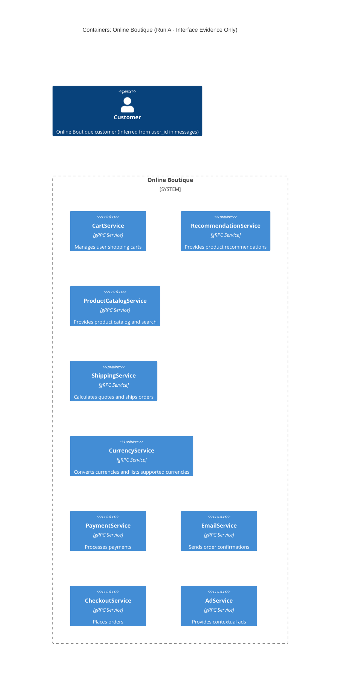

# Architecture Recovery - Run A

## 1. Agent
- **Product:** Antigravity / Gemini CLI
- **Model:** Gemini 3.8 Flash

## 2. Files read
- `prompts/1-recover-architecture.md`
- `system/online-boutique/protos/demo.proto`

## 3. Containers table

| Name | Technology / Language | Responsibility | Evidence (file path) |
|---|---|---|---|
| CartService | gRPC Service (Implementation language not evidenced) | Manages user shopping carts (AddItem, GetCart, EmptyCart) | `system/online-boutique/protos/demo.proto` (L23-27) |
| RecommendationService | gRPC Service (Implementation language not evidenced) | Generates product recommendations based on user ID and product IDs (ListRecommendations) | `system/online-boutique/protos/demo.proto` (L56-58) |
| ProductCatalogService | gRPC Service (Implementation language not evidenced) | Provides product catalog listings, item details, and product search (ListProducts, GetProduct, SearchProducts) | `system/online-boutique/protos/demo.proto` (L71-75) |
| ShippingService | gRPC Service (Implementation language not evidenced) | Calculates shipping price quotes and ships orders (GetQuote, ShipOrder) | `system/online-boutique/protos/demo.proto` (L107-110) |
| CurrencyService | gRPC Service (Implementation language not evidenced) | Converts money between currencies and lists supported currencies (GetSupportedCurrencies, Convert) | `system/online-boutique/protos/demo.proto` (L140-143) |
| PaymentService | gRPC Service (Implementation language not evidenced) | Processes credit card charges (Charge) | `system/online-boutique/protos/demo.proto` (L177-179) |
| EmailService | gRPC Service (Implementation language not evidenced) | Sends order confirmation emails (SendOrderConfirmation) | `system/online-boutique/protos/demo.proto` (L199-201) |
| CheckoutService | gRPC Service (Implementation language not evidenced) | Coordinates and places customer orders (PlaceOrder) | `system/online-boutique/protos/demo.proto` (L224-226) |
| AdService | gRPC Service (Implementation language not evidenced) | Provides contextual advertisements based on page context keys (GetAds) | `system/online-boutique/protos/demo.proto` (L243-245) |

## 4. Dependencies table

| Caller → Callee | Protocol | Evidence |
|---|---|---|
| *Not evidenced in the provided files* | — | `demo.proto` defines RPC server interfaces only; it contains no runtime caller or call graph information. |

## 5. Mermaid diagram

## 6. Gaps

1. **Runtime Caller → Callee Dependencies:**
   - *What is missing:* Protobuf service definitions specify available RPC endpoints, but do not show which service initiates calls to another service.
   - *File to settle it:* Service source code (`system/online-boutique/src/*/`) or deployment manifests specifying service addresses/environment variables (`system/online-boutique/kubernetes-manifests/`).

2. **Frontend / Web UI / Ingress:**
   - *What is missing:* No user-facing frontend or API gateway is defined in `demo.proto`.
   - *File to settle it:* `system/online-boutique/kubernetes-manifests/frontend.yaml` or `system/online-boutique/src/frontend/`.

3. **Data Stores and Databases:**
   - *What is missing:* No persistence layer (e.g., SQL databases, Redis caches) is indicated in the protobuf contract.
   - *File to settle it:* Kubernetes manifests (`system/online-boutique/kubernetes-manifests/`) or source code configuration files.

4. **Service Implementation Languages / Technologies:**
   - *What is missing:* The programming language and framework used to implement each gRPC service cannot be determined from `.proto` files alone (except that `option go_package` is present for Go package generation).
   - *File to settle it:* Service source trees (`system/online-boutique/src/`) or container images specified in `system/online-boutique/kubernetes-manifests/`.

5. **External Systems:**
   - *What is missing:* Whether payment and email services use external third-party APIs (e.g., Stripe, SendGrid) or purely mock/in-house logic.
   - *File to settle it:* Source code of `paymentservice` and `emailservice`.
