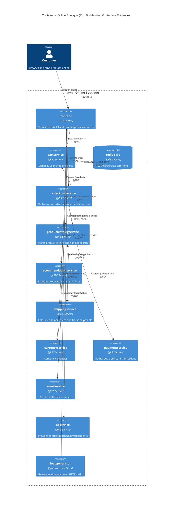

# Architecture Recovery - Run B

## 1. Agent
- **Product:** Antigravity / Gemini CLI
- **Model:** Gemini 3.8 Flash

## 2. Files read
- `prompts/1-recover-architecture.md`
- `system/online-boutique/protos/demo.proto`
- `system/online-boutique/kubernetes-manifests/kustomization.yaml`
- `system/online-boutique/kubernetes-manifests/frontend.yaml`
- `system/online-boutique/kubernetes-manifests/cartservice.yaml`
- `system/online-boutique/kubernetes-manifests/checkoutservice.yaml`
- `system/online-boutique/kubernetes-manifests/recommendationservice.yaml`
- `system/online-boutique/kubernetes-manifests/productcatalogservice.yaml`
- `system/online-boutique/kubernetes-manifests/shippingservice.yaml`
- `system/online-boutique/kubernetes-manifests/currencyservice.yaml`
- `system/online-boutique/kubernetes-manifests/paymentservice.yaml`
- `system/online-boutique/kubernetes-manifests/emailservice.yaml`
- `system/online-boutique/kubernetes-manifests/adservice.yaml`
- `system/online-boutique/kubernetes-manifests/loadgenerator.yaml`

## 3. Containers table

| Name | Technology / Language | Responsibility | Evidence (file path) |
|---|---|---|---|
| frontend | HTTP / Web Container (Language not evidenced in manifests) | Serves HTML/HTTP traffic to users, coordinates requests to backend services | `system/online-boutique/kubernetes-manifests/frontend.yaml` (Deployment `frontend`, Service `frontend`, Service `frontend-external`) |
| cartservice | gRPC Service (Language not evidenced in manifests) | Manages shopping cart items; persists items into Redis | `system/online-boutique/kubernetes-manifests/cartservice.yaml` (Deployment `cartservice`), `system/online-boutique/protos/demo.proto` (service `CartService`) |
| redis-cart | Redis 7+ (`redis:alpine`) | In-memory key-value data store holding shopping cart data for `cartservice` | `system/online-boutique/kubernetes-manifests/cartservice.yaml` (Deployment `redis-cart`, Service `redis-cart`) |
| checkoutservice | gRPC Service (Language not evidenced in manifests) | Orchestrates checkout, payment, shipping, and email notifications | `system/online-boutique/kubernetes-manifests/checkoutservice.yaml` (Deployment `checkoutservice`), `system/online-boutique/protos/demo.proto` (service `CheckoutService`) |
| productcatalogservice | gRPC Service (Language not evidenced in manifests) | Stores and serves product catalog data and search | `system/online-boutique/kubernetes-manifests/productcatalogservice.yaml` (Deployment `productcatalogservice`), `system/online-boutique/protos/demo.proto` (service `ProductCatalogService`) |
| recommendationservice | gRPC Service (Language not evidenced in manifests) | Computes recommended products based on user and catalog | `system/online-boutique/kubernetes-manifests/recommendationservice.yaml` (Deployment `recommendationservice`), `system/online-boutique/protos/demo.proto` (service `RecommendationService`) |
| shippingservice | gRPC Service (Language not evidenced in manifests) | Calculates shipping fees and generates tracking IDs | `system/online-boutique/kubernetes-manifests/shippingservice.yaml` (Deployment `shippingservice`), `system/online-boutique/protos/demo.proto` (service `ShippingService`) |
| currencyservice | gRPC Service (Language not evidenced in manifests) | Provides currency conversion rates and supported currencies | `system/online-boutique/kubernetes-manifests/currencyservice.yaml` (Deployment `currencyservice`), `system/online-boutique/protos/demo.proto` (service `CurrencyService`) |
| paymentservice | gRPC Service (Language not evidenced in manifests) | Validates and charges credit card transactions | `system/online-boutique/kubernetes-manifests/paymentservice.yaml` (Deployment `paymentservice`), `system/online-boutique/protos/demo.proto` (service `PaymentService`) |
| emailservice | gRPC Service (Language not evidenced in manifests) | Sends order confirmation emails | `system/online-boutique/kubernetes-manifests/emailservice.yaml` (Deployment `emailservice`), `system/online-boutique/protos/demo.proto` (service `EmailService`) |
| adservice | gRPC Service (Language not evidenced in manifests) | Serves contextual advertisements based on page keywords | `system/online-boutique/kubernetes-manifests/adservice.yaml` (Deployment `adservice`), `system/online-boutique/protos/demo.proto` (service `AdService`) |
| loadgenerator | Synthetic Traffic Generator Container | Generates synthetic simulated user HTTP traffic against frontend | `system/online-boutique/kubernetes-manifests/loadgenerator.yaml` (Deployment `loadgenerator`) |

## 4. Dependencies table

| Caller → Callee | Protocol | Evidence |
|---|---|---|
| Customer → frontend | HTTP | `system/online-boutique/kubernetes-manifests/frontend.yaml` (Service `frontend-external`, port 80 → targetPort 8080) |
| loadgenerator → frontend | HTTP | `system/online-boutique/kubernetes-manifests/loadgenerator.yaml` (`FRONTEND_ADDR="frontend:80"`, wget probe) |
| frontend → productcatalogservice | gRPC | `system/online-boutique/kubernetes-manifests/frontend.yaml` (`PRODUCT_CATALOG_SERVICE_ADDR="productcatalogservice:3550"`), `system/online-boutique/protos/demo.proto` |
| frontend → currencyservice | gRPC | `system/online-boutique/kubernetes-manifests/frontend.yaml` (`CURRENCY_SERVICE_ADDR="currencyservice:7000"`), `system/online-boutique/protos/demo.proto` |
| frontend → cartservice | gRPC | `system/online-boutique/kubernetes-manifests/frontend.yaml` (`CART_SERVICE_ADDR="cartservice:7070"`), `system/online-boutique/protos/demo.proto` |
| frontend → recommendationservice | gRPC | `system/online-boutique/kubernetes-manifests/frontend.yaml` (`RECOMMENDATION_SERVICE_ADDR="recommendationservice:8080"`), `system/online-boutique/protos/demo.proto` |
| frontend → shippingservice | gRPC | `system/online-boutique/kubernetes-manifests/frontend.yaml` (`SHIPPING_SERVICE_ADDR="shippingservice:50051"`), `system/online-boutique/protos/demo.proto` |
| frontend → checkoutservice | gRPC | `system/online-boutique/kubernetes-manifests/frontend.yaml` (`CHECKOUT_SERVICE_ADDR="checkoutservice:5050"`), `system/online-boutique/protos/demo.proto` |
| frontend → adservice | gRPC | `system/online-boutique/kubernetes-manifests/frontend.yaml` (`AD_SERVICE_ADDR="adservice:9555"`), `system/online-boutique/protos/demo.proto` |
| cartservice → redis-cart | TCP (Redis) | `system/online-boutique/kubernetes-manifests/cartservice.yaml` (`REDIS_ADDR="redis-cart:6379"`, Service `redis-cart` port 6379 name `tcp-redis`) |
| checkoutservice → productcatalogservice | gRPC | `system/online-boutique/kubernetes-manifests/checkoutservice.yaml` (`PRODUCT_CATALOG_SERVICE_ADDR="productcatalogservice:3550"`), `system/online-boutique/protos/demo.proto` |
| checkoutservice → shippingservice | gRPC | `system/online-boutique/kubernetes-manifests/checkoutservice.yaml` (`SHIPPING_SERVICE_ADDR="shippingservice:50051"`), `system/online-boutique/protos/demo.proto` |
| checkoutservice → paymentservice | gRPC | `system/online-boutique/kubernetes-manifests/checkoutservice.yaml` (`PAYMENT_SERVICE_ADDR="paymentservice:50051"`), `system/online-boutique/protos/demo.proto` |
| checkoutservice → emailservice | gRPC | `system/online-boutique/kubernetes-manifests/checkoutservice.yaml` (`EMAIL_SERVICE_ADDR="emailservice:5000"`), `system/online-boutique/protos/demo.proto` |
| checkoutservice → currencyservice | gRPC | `system/online-boutique/kubernetes-manifests/checkoutservice.yaml` (`CURRENCY_SERVICE_ADDR="currencyservice:7000"`), `system/online-boutique/protos/demo.proto` |
| checkoutservice → cartservice | gRPC | `system/online-boutique/kubernetes-manifests/checkoutservice.yaml` (`CART_SERVICE_ADDR="cartservice:7070"`), `system/online-boutique/protos/demo.proto` |
| recommendationservice → productcatalogservice | gRPC | `system/online-boutique/kubernetes-manifests/recommendationservice.yaml` (`PRODUCT_CATALOG_SERVICE_ADDR="productcatalogservice:3550"`), `system/online-boutique/protos/demo.proto` |

## 5. Mermaid diagram

## 6. Gaps

1. **Programming Language and Frameworks for Microservices:**
   - *What is missing:* Manifests specify container image tags (e.g. `image: frontend`, `image: cartservice`) without indicating programming languages (Go, Java, Python, C#, Node.js) or web frameworks used.
   - *File to settle it:* Service source code directories under `system/online-boutique/src/*/` (e.g., `package.json`, `go.mod`, `pom.xml`, `requirements.txt`).

2. **Shopping Assistant Service Status:**
   - *What is missing:* `frontend.yaml` defines `SHOPPING_ASSISTANT_SERVICE_ADDR="shoppingassistantservice:80"`, but there is no `shoppingassistantservice.yaml` active in `kubernetes-manifests/`, and `kustomization.yaml` comments out `shopping-assistant`. It is unclear whether this service is planned, optional, or active in other deployment environments.
   - *File to settle it:* `kustomize/components/shopping-assistant` or optional manifests.

3. **External Integrations (Payment Gateway & Mail Server):**
   - *What is missing:* Manifests do not reveal external API endpoints or credentials for third-party email providers (e.g. SendGrid) or payment processors (e.g. Stripe). It is unclear whether `paymentservice` and `emailservice` perform real external API calls or mock processing.
   - *File to settle it:* Source code of `system/online-boutique/src/paymentservice/` and `system/online-boutique/src/emailservice/`.

4. **Product Catalog Persistence:**
   - *What is missing:* `productcatalogservice` has no associated database container manifest or persistence volume in `kubernetes-manifests/`. Does it store products in-memory, read from a static local JSON file, or connect to an unlisted database?
   - *File to settle it:* `system/online-boutique/src/productcatalogservice/products.json` or service source files.
